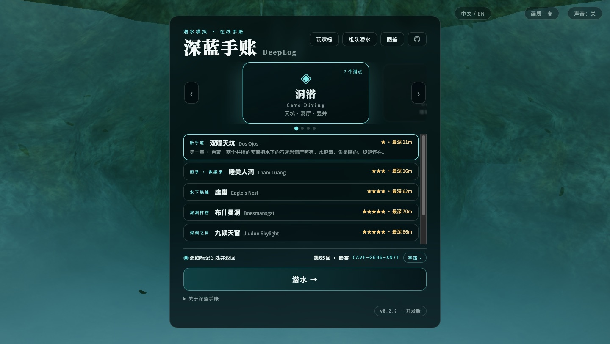
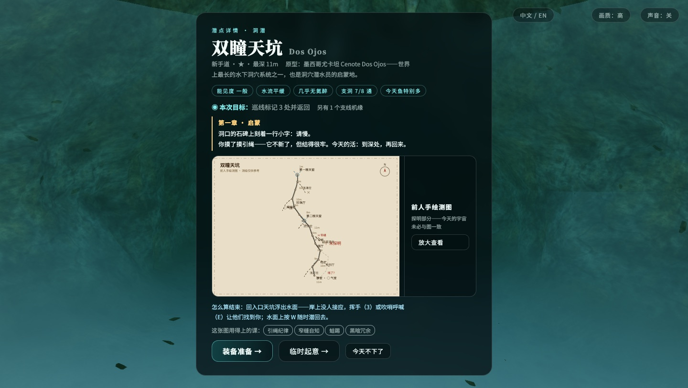
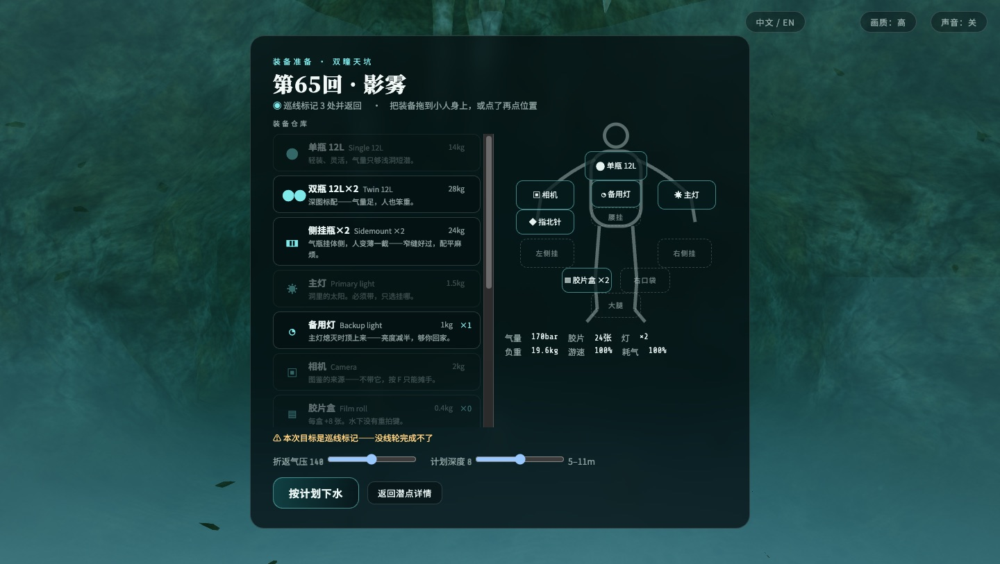
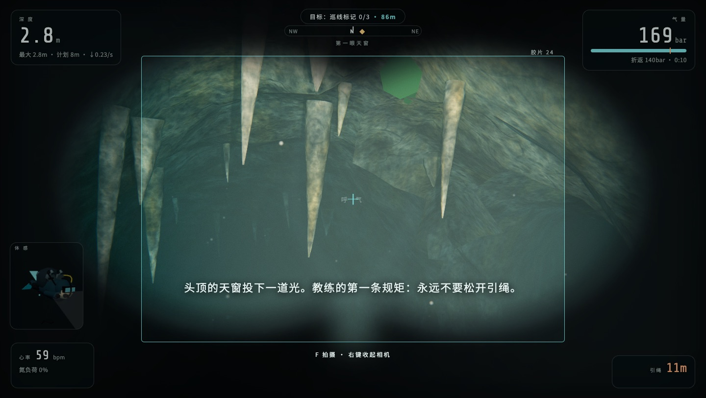

# DeepLog 深蓝手账 · 在线潜水模拟

> 戴上头灯，抓稳引绳，进洞。

**DeepLog** 是跑在浏览器里的写实向 3D 潜水模拟：不用下载、不用装任何东西，打开就潜。地图全部改编自真实洞潜地点与事故；每个种子生成一个"平行宇宙"；活下来还是出事故，都会写进你的手账。

中文 / English 一键切换（右上角），单人 + 最多 4 人联机，手机也能潜。



## 潜一次，是这样的

**① 看潜点档案**——天气、能见度、水流、氮醉、支线机缘，和前人手绘的测图。今天的宇宙未必与图一致。



**② 进装备间配装**——把气瓶、主灯、相机、线轮、浮标从仓库拖到自己身上。带多少、挂哪、负重多少，下水前最后一眼都看得见；忘带的东西，洞里会找你算账。也可以「临时起意」，抓起基础装就走——代价是可能少带了什么。



**③ 入水**——天窗的光柱随深度指数衰减，十几米后世界只剩你的灯。沿引绳推进，气量、免减压表、氮醉、惊慌都在后台替你记着。

**④ 干活**——本宇宙的目标可能是：摸标记石并返回、拍到指定生物（按居中度/距离/光照评 1–3 星进图鉴）、打捞失物（比你想象的重）、搜救拖带被困者、沿线布巡线标记。



**⑤ 活着回来**——洞潜铁律是三分之一法则：1/3 进去，1/3 出来，1/3 留命。抓引绳限速爬升，做完安全停留，出水。

**⑥ 写进手账**——结算给结局文案，照片进图鉴，轨迹存「复盘回放」；换一个宇宙，再来一次。

## 你可能会死在哪

气尽、减压病、氮醉上头、氧中毒、惊慌、泥沙迷路、弄丢引绳、窄缝卡住、调节器自由流、主灯熄灭、潜伴失散、失踪……每种结局都来自真实事故复盘，附一句"错在哪"。以及，罕见的好结局：「获救」。

## 地图与原型

| 地图 | 原型 |
|---|---|
| 双瞳天坑 | 墨西哥尤卡坦 Cenote Dos Ojos——新手启蒙地 |
| 睡美人洞 | 泰国清莱 · 2018 野猪队救援事件 |
| 鹰巢 | 美国佛州 Eagle's Nest，「水下的珠穆朗玛」 |
| 布什曼洞 | 南非 Boesmansgat，2005 年 Dave Shaw 打捞遇难 |
| 九顿天窗 | 广西都安 · 2023 年韩颋冲击深度纪录失联 |
| 魔鬼之眼 | 美国佛州 Ginnie Springs / Devil's Eye |
| 蓝潭地下河 | 虚构（致敬参考站第二关） |

海潜（珊瑚礁 / 沉船）、冰潜（冰盖湖 / 冰山之下）也已开放——出水放浮标（C）让船找到你，或者沿安全绳爬回冰洞。


## 还有这些

- **教学课程**：OW 开放水域 → AOW 进阶 → 战术潜水员，十几节考核课，从面镜排水考到水下导航——教练全程盯着，考过发证。
- **联机组队**：房间制大厅（4 位房间码），同一宇宙里各潜各的，看得见彼此的灯；一个人先下水也行，AI 潜伴会跟着你。
- **潜伴档案馆**：账号与 IP 绑定免登录，昵称自取；图鉴、章节、生涯、回放云端同步；玩家榜按综合分排。
- **版本通道**：菜单右下角版本号可切 稳定版 / 预览版——预览版更新更勤。
- **体感小人**：左下角 3D 小人实时跟你的俯仰、踢水、BCD 鼓瘪、侧挂瓶。

## 快速开始

需要 Node.js ≥ 20：

```bash
npm install && npm run dev    # → http://localhost:5173
npm run build && npm start    # 生产：8790 托管 dist + /ws 联机
```

静态托管（Cloudflare Pages 等）：build `npm run build`，输出 `client/dist`，Node 20。联机与账号云端化可选 Supabase（`VITE_SUPABASE_URL/ANON_KEY`，库表跑一遍 `server/supabase.sql`），或自建 `server/` 设 `VITE_WS_URL`；都不配则组队回落单人。详见 `client/.env.example`。

## 操作

WASD 游动 · 鼠标视角 · 空格快踢 · K 蛙踢 · F 相机（再按拍摄 · **右键收起**）· E 互动 · G 抓引绳 · L 灯 · B/V 浮力 · C 浮标(海潜) · 1–5 手势 · Tab 全键位表 · Esc 暂停。

## 开发

渲染管线、宇宙生成、课程引擎等实现细节见 [docs/DESIGN.md](docs/DESIGN.md) 与 `AGENTS.md`。跑 `npm test`（世界生成 + 联机 + i18n）与 `npm run shots`（画面验收）后再提 PR。

## License

[Apache-2.0](LICENSE)

---

## English

**DeepLog** is a browser-based realistic dive simulator & journal — no download, open and dive. Maps are adapted from real caves and real accidents (Cenote Dos Ojos, the 2018 Tham Luang rescue, Eagle's Nest, Boesmansgat, Jiudun). Every seed spins a different "parallel universe" — same map, different objective, branches, events.

Read the site file, then drag tanks/lights/cameras onto your diver in the gear room — what you forgot, the cave will collect. Dive the line, do the objective (marker stones, graded photography for the codex, salvage, rescue towing, line surveying), manage gas by thirds, ascend slow, surface. Survive or die, it goes in your logbook — every ending is drawn from a real incident report.

Solo with an AI buddy or up to 4 players online; OW → AOW → combat-diver courses graded keystroke by keystroke; photo codex, replay archive, cloud-synced diver board; Chinese/English toggle.

```bash
npm install && npm run dev    # → http://localhost:5173, Node ≥ 20
```

WASD swim · mouse look · Space kick · K frog-kick · F camera (again to shoot, **right-click to stow**) · E interact · G grab line · B/V buoyancy · C SMB · 1–5 gestures · Tab key list · Esc pause.
