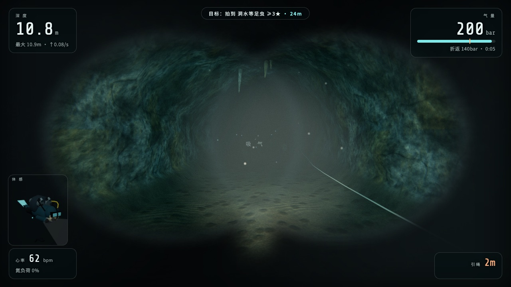
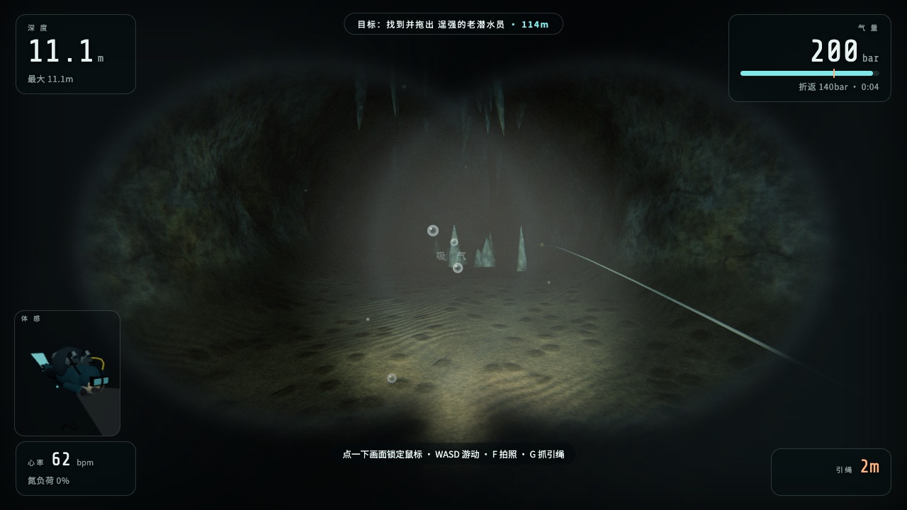
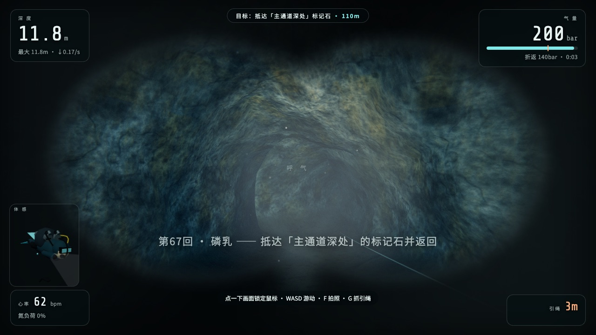
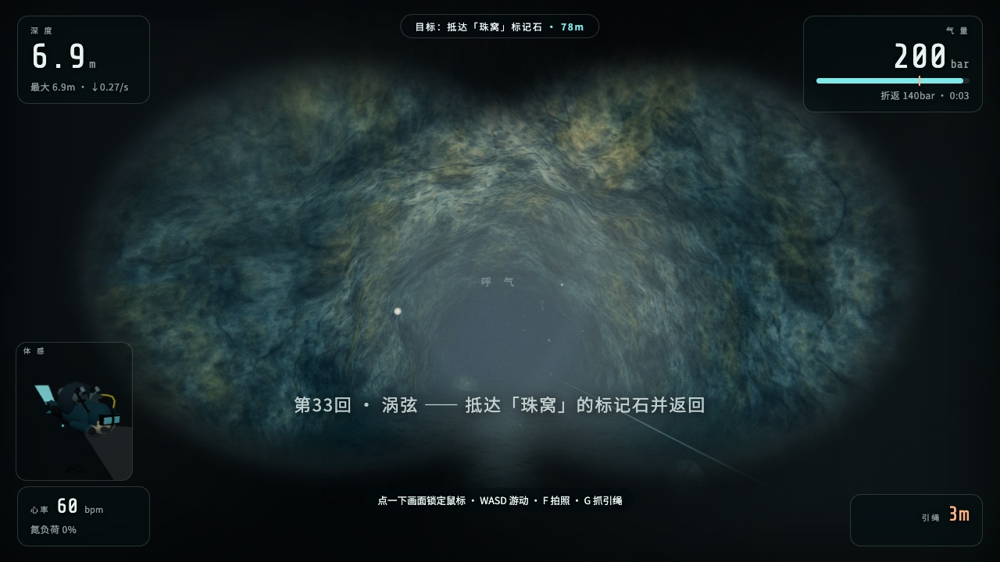

# DeepLog 深蓝手账 · 在线潜水模拟

> 戴上头灯，抓稳引绳，进洞。

DeepLog（深蓝手账）是一个跑在浏览器里的 **写实向 3D 潜水模拟与手账**（Three.js 渲染，无外部美术素材，全部程序化生成）：下水、拍照、复盘、收集。目前开放**洞穴潜水**（含教学课程），**海潜、冰潜**在路线图上；地图以真实洞潜事故与传说改编。支持**中文 / English** 一键切换（右上角按钮）。

支持**单人 / 多人联机**、**拍照图鉴收集**、**平行宇宙**（种子化随机世界）、**教学考核**（OW / AOW / 战术潜水），以及一整套会要人命的**潜水生理模拟**。






## 特性

- **真实事件改编的地图**：睡美人洞 2018 救援、Eagle's Nest、Boesmansgat（Dave Shaw）、九顿天窗（韩颋）……每张图都标注了原型。
- **平行宇宙**：同一张地图换一颗种子，目标、布点、装饰全部重排。世界由 `(mapId, seed)` 确定性生成——联机只传位姿与事件，不同步世界本体，天然防作弊也省带宽。
- **会死人的生理模拟**：气量消耗（深度×活动）、免减压表、氮醉、惊慌、上升限速、氧中毒、泥沙迷路、断绳、卡缝、调节器自由流、灯故障——每一种失误都对应一个真实复盘里出现过的「结局」。
- **拍照图鉴**：取景、打光、按 F。按居中度 / 距离 / 光照评 1–3 星，收录 13 种洞穴生物与地质条目（盲鱼、洞穴珍珠、卷曲石、硫磺菌毯……）。
- **教学模式**：OW 开放水域 → AOW 进阶 → 战术潜水员（CCR）三个课程、14 节考核课，从面镜排水考到爆破物布放。
- **联机**：房间制大厅，位姿与事件实时转发，同一宇宙里各潜各的、互相能看见灯。

## 快速开始

需要 Node.js ≥ 20。

```bash
npm install        # 安装依赖（npm workspaces: client / server / shared）
npm run dev        # 开发模式：vite(5173) + 联机服务器(8790) 一起起
```

打开 <http://localhost:5173>，点一下画面锁定鼠标，WASD 下水。

生产部署（自托管联机）：

```bash
npm run build      # 构建 client -> client/dist
npm start          # 8790 端口托管 dist + /ws 联机通道（PORT 环境变量可改）
```

### 部署到 Cloudflare Pages（纯静态，联机走 Supabase）

游戏全部玩法（单机、教学、图鉴、平行宇宙）都在浏览器端运行，可以整站托管到 Pages：

| 项目设置 | 值 |
|---|---|
| Build command | `npm run build` |
| Build output | `client/dist` |
| Node version | `20`（仓库里有 `.nvmrc`） |

根目录 `wrangler.toml` 已写好 `pages_build_output_dir`，也可以直接 `npx wrangler pages deploy client/dist`。

**联机（Supabase Realtime）**：房间大厅与位姿转发走 Supabase Realtime 频道（presence + broadcast），不需要自建服务端、不需要建表：

1. [supabase.com](https://supabase.com) 建一个免费项目（Realtime 默认开启）；
2. Project Settings → API 拿到 `Project URL` 和 `anon public key`；
3. 在 Pages 构建环境变量（或本地 `client/.env`，见 `client/.env.example`）里加：
   ```
   VITE_SUPABASE_URL=https://你的项目.supabase.co
   VITE_SUPABASE_ANON_KEY=你的anon-key
   ```
4. 重新构建部署。「组队潜水」即可开房/进房（4 位房间码，最多 4 人同潜）。

anon key 本来就是设计给前端用的公开 key；本项目不读写数据库，只用 Realtime 频道。

> **备选**：也可以把 `server/` 部署到任意支持 WebSocket 的 Node 托管（Railway / Fly / 自有 VPS），构建时设 `VITE_WS_URL=wss://你的域名/ws`。两个都没配时，「组队潜水」会提示并回落单人。

## 怎么玩

### 一局的标准流程

1. **选图**：主菜单选地图与宇宙种子；背景就是该洞的实时巡游预览。
2. **做计划**：设气瓶容量与折返气量——洞潜铁律是三分之一法则。
3. **入水**：从天窗下的水面下潜，环境光随深度指数衰减，十几米后只剩你的灯。
4. **进洞**：沿引绳推进。灯束照不到的地方就是不存在的地方。
5. **完成目标**：见下表。
6. **返程**：回到引绳、控制上升速度、做完安全停留，活着出水。
7. **结算**：拿结局文案，照片进图鉴；换一个宇宙再来。

### 目标类型

| 类型 | 说明 |
|---|---|
| 探索标记 | 抵达目标洞厅，摸标记石，活着回来 |
| 指定拍摄 | 拍到目标生物/地质，照片评分合格才算数 |
| 打捞回收 | 找到遗失物带回出口——它比你想象的重 |
| 搜救拖带 | 找到被困者，挂拖带，慢—慢—带出来 |

### 操作

| 按键 | 功能 | 按键 | 功能 |
|---|---|---|---|
| WASD | 游动 | 鼠标 | 视角（点击画面锁定） |
| 空格 | 快踢（会搅沙） | K | 蛙踢（不搅沙） |
| F | 取景器 / 拍摄 | E | 互动 |
| G | 抓引绳（自动限速爬升） | L | 主灯 |
| Q | 备用二级头 | R | 二级头排水 |
| M | 摘/戴面镜 | H | 压面镜上沿排水 |
| N | 鼻吐气 | X | 捏鼻（耳压平衡） |
| B / V | BCD 充气 / 排气 | O | CCR 模式 |
| I / U | 手动吸 / 呼气 | 1–5 | 水下手势 |
| Tab | 键位表 | Esc | 暂停 |

移动端：左侧摇杆 + 右侧按钮，右半屏拖动视角。

### 生理与结局

游戏会计算气量（深度越深耗气越快）、氮负荷（免减压表插值）、氮醉（24m 以下开始上头）、惊慌、上升速度（>1.0m/s 持续 4 秒判减压病）、氧中毒（>65m 确定性暴露计时）。踢水搅起的泥沙会真实地毁掉能见度；脱手引绳在泥沙里等于失踪。

结算时按死因/生还方式给结局：减压病、气尽、泥沙迷路、弄丢引绳、氮醉、惊慌、卡缝、潜伴失散、氧中毒、自由流耗尽、失踪……以及罕见的「获救」。每种结局附一句复盘式的提示——错在哪，下一局别犯。

### 教学模式

主菜单 →「教学课程」→ 课程表 → 下水考核。每节课是一串考核步骤（按键 / 组合 / 面镜排水 / 深度 / 到达 / 布放 / 手势 / 潜伴 / CCR / 上升 / 拍照……），全部通过才发证。

| 课程 | 内容 |
|---|---|
| OW 开放水域潜水员 | 装备检查、面镜排水、调节器脱落、中性浮力、手势、安全上升 |
| AOW 进阶开放水域 | 共生呼吸、水下导航、进阶悬浮、蛙踢过沙地、目标拍摄 |
| 战术潜水员 | CCR 行前检查、静默渗透、爆破物布放（军港夜潜图） |

## 地图

| 地图 | 原型 |
|---|---|
| 双瞳天坑 | 墨西哥尤卡坦 Cenote Dos Ojos |
| 睡美人洞 | 泰国清莱睡美人洞 · 2018 野猪队救援事件 |
| 鹰巢 | 美国佛州 Eagle's Nest，「水下的珠穆朗玛」 |
| 布什曼洞 | 南非 Boesmansgat，2005 年 Dave Shaw 打捞遇难 |
| 九顿天窗 | 广西都安九顿天窗，2023 年韩颋冲击深度纪录失联 |
| 蓝潭地下河 | 虚构（致敬参考站第二关） |
| 魔鬼之眼 | 美国佛州 Ginnie Springs / Devil's Eye |
| 训练池 / 军港夜潜 | 教学专用，不出现在选图列表 |

## 技术架构

npm workspaces 单仓三包，前后端共用同一份世界生成代码：

```
shared/    双端共用：种子RNG、地图数据、平行宇宙生成、联机协议、物种/结局图鉴、课程
client/    Vite + Three.js
  src/engine/  洞穴网格放样+碰撞场、水下氛围、泥沙、生物、潜水员模型、程序贴图
  src/game/    会话总控、玩家物理+生理、AI潜伴、目标、拍照、联机、输入、音频、教学引擎
  src/ui/      菜单/大厅/结算/图鉴/课程表、HUD、体感小人
server/    Node + ws：静态托管 + 房间/大厅/位姿转发
scripts/   dev 启动器、冒烟测试、世界测试、画面截图验收、e2e
```

几个核心设计：

- **洞穴生成**：脊线放样成管状网格（沉积地面、扇贝纹、天窗收口），无外部模型。贴图由周期噪声程序化生成（albedo + 法线 + 粗糙度）。
- **碰撞 = 走廊约束**：玩家到骨架线段的距离不得超过该段半径。渲染与碰撞共用同一个 `wallRadius()`，所见即所碰。
- **能见度是玩法**：Beer–Lambert 分通道水下雾（红光衰减最快），密度由地图能见度 × 泥沙浓度 × 氮醉共同决定。
- **平行宇宙确定性**：同一 `(mapId, seed)` 在所有客户端生成同一个世界；画质档位只改精细度、不改布局。
- **后期**：体积光（灯束/天窗光柱丁达尔散射）+ UnrealBloom + ACES + 水下通道（面镜暗角、色散、氮醉扭曲）。低/中/高三档画质，触屏默认低档。

详细设计文档见 [docs/DESIGN.md](docs/DESIGN.md)。

## 开发与测试

```bash
npm test           # worldtest（世界生成/碰撞一致性）+ smoke（宇宙确定性 + ws 全流程）
npm run smoke      # 仅联机/宇宙冒烟
node scripts/worldtest.mjs           # 仅世界生成/碰撞测试
npm run shots      # 画面验收：全地图截图 + 亮度/过曝/帧率/报错门禁（需先 npm run dev）
npm run shots -- --quality=low|mid|high    # 按画质档位验收
node scripts/e2e_train.mjs --url=http://localhost:5173   # 教学考核 e2e
```

改动渲染相关代码后，请跑 `npm test` 和三档画质的 `npm run shots`，并人工查看 `reports/shots/`。

## 参与贡献

欢迎 Issue 与 PR：

- 提 PR 前请确保 `npm test` 通过；涉及渲染的改动附 `npm run shots` 结果。
- 加新地图：在 `shared/maps.js` 按现有结构写脊线/洞厅/岔路数据，`basedOn` 注明原型出处。
- 加新课节：在 `shared/courses.js` 的步骤序列里组合 check 类型（文件头有完整注释）。
- 游戏内文案、结局文案、物种图鉴条目的打磨也非常欢迎。

## License

[Apache-2.0](LICENSE)

---

## English

**DeepLog** is a browser-based realistic dive simulator & journal (cave diving today; ocean and ice diving planned) (Three.js, fully procedural — no external art assets), inspired by the Chinese cave-diving debrief community. Solo & online multiplayer, photo-collection codex, seeded "parallel universe" world generation, and a physiology model that will actually kill you: gas planning, no-decompression limits, nitrogen narcosis, panic, ascent-rate limits, oxygen toxicity, silt-outs, lost guide lines, stuck restrictions, free-flow and light failures — each maps to an "ending" taken from real accident reports.

Maps are adapted from real sites and events: Cenote Dos Ojos, the 2018 Tham Luang rescue, Eagle's Nest, Boesmansgat (Dave Shaw), Jiudun Skylight (Han Ting), Ginnie Springs / Devil's Eye.

```bash
npm install && npm run dev   # Node ≥ 20 → http://localhost:5173
npm run build && npm start   # production, serves on :8790 with /ws multiplayer
```

Deploy to Cloudflare Pages (static): build command `npm run build`, output dir `client/dist`, Node 20. For multiplayer on a static host, create a free Supabase project and set `VITE_SUPABASE_URL` + `VITE_SUPABASE_ANON_KEY` in the Pages build environment (Realtime channels only — no tables or functions needed). Alternatively host `server/` on any WebSocket-capable Node host and set `VITE_WS_URL=wss://your-host/ws`.

Controls: WASD swim, mouse look, Space kick, K frog-kick, F camera, E interact, G hold guideline, L light, B/V BCD inflate/vent, Esc pause. Mobile: left stick + on-screen buttons. Training mode walks you through OW → AOW → CCR combat-diver courses.

Contributions welcome — run `npm test` before submitting. Apache-2.0.
